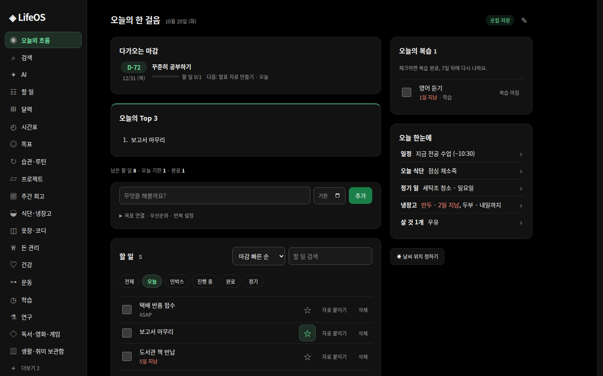
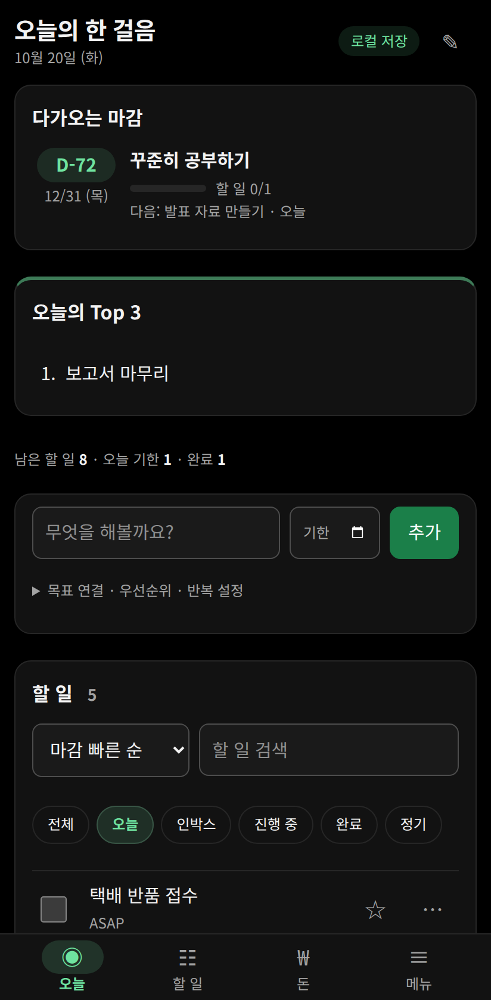
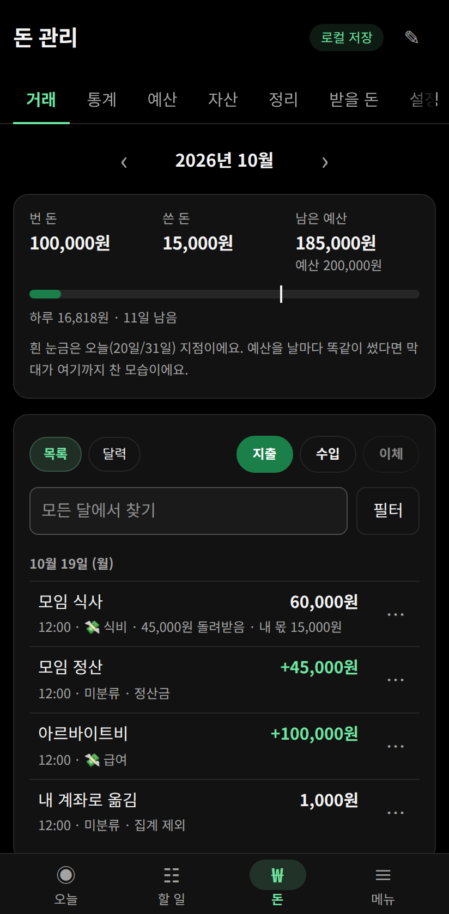
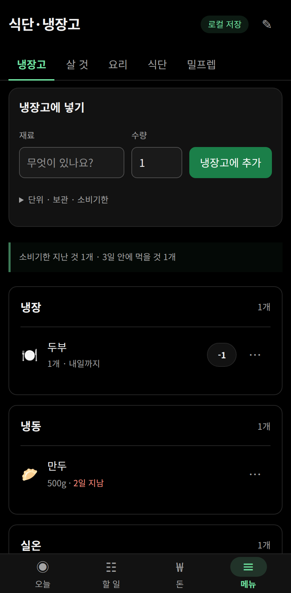

# LifeOS

할 일, 달력, 시간표, 습관, 목표, 프로젝트, 돈 관리, 식단·냉장고, 옷장, 건강·운동, 공부, 연구 노트, 독서·영화 기록을 한 앱에 모은 개인 기록 앱입니다.

- 회원 가입이 없습니다. 기록은 설치한 기기에만 저장됩니다.
- Android 폰과 Ubuntu PC에서 씁니다. Windows 판은 준비 중입니다.
- 화면은 한국어이고, 날짜는 기기의 시간대와 상관없이 한국 시간으로 셉니다.

<p align="center"></p>
<p align="center">
  
  
  
</p>
<p align="center"><sub>사진 속 기록은 예시입니다.</sub></p>

## 받기

[최신 판 받기](../../releases/latest)에서 기기에 맞는 파일을 받으세요.

| 기기 | 파일 |
| --- | --- |
| Android 8 이상 | `LifeOS-public-<판>.apk` |
| Ubuntu 22.04 이상, amd64 (24.04에서 확인) | `lifeos-public_<판>_amd64.deb` |
| Windows | 준비 중 |

릴리스 설명에 파일마다 SHA-256이 적혀 있습니다. 받은 파일이 온전한지는 PC에서 `sha256sum <파일 이름>`으로 확인할 수 있습니다.

## Android에 설치하기

1. 폰 브라우저에서 APK를 받아 엽니다.
2. 설치를 막는 창이 나오면 **설정**을 눌러, 파일을 연 앱(Chrome이나 내 파일)의 **이 출처 허용**을 켜고 돌아와 설치합니다.
   - 갤럭시에서 미리 켜 두려면: 설정 › 애플리케이션 › ⋮(더보기) › 특별한 접근 › 출처를 알 수 없는 앱 설치 › Chrome(또는 내 파일) › 이 출처 허용
3. 갤럭시에서 **보안 위험 자동 차단** 때문에 막히면, 설정 › 보안 및 개인정보 보호 › 보안 위험 자동 차단을 잠시 끄고 설치한 뒤 다시 켭니다. 이 기능이 켜져 있으면 새 판으로 업데이트도 안 되니, 업데이트할 때도 잠시 끕니다.
4. Play 스토어에서 받은 앱이 아니어서 Play 프로텍트가 경고할 수 있습니다. 내용을 읽고 설치를 계속할지 정하세요.

홈 화면에 **LifeOS 할 일**, **LifeOS 달력**, **LifeOS 예산**(넓게, 작게, 한 줄) 위젯을 놓을 수 있습니다.

### 앱이 쓰는 권한

문자, 알림, 건강, 마이크 권한은 그 기능을 쓸 때 Android가 따로 묻습니다. 허락하지 않아도 다른 기능은 그대로 쓸 수 있습니다.

| 권한 | 쓰는 곳 |
| --- | --- |
| 알림 읽기, 문자 읽기 | 돈 관리 › 설정 › 자동 기록. 카드·페이·은행 앱의 결제 알림과 결제 문자를 읽어 지출로 적습니다. 직접 켜기 전에는 읽지 않고, 읽은 내용은 폰 밖으로 보내지 않습니다. |
| 알림 표시 | 결제를 감지했을 때 분류를 고르는 알림, 예산 알림 |
| 건강 데이터 읽기 (헬스 커넥트) | 건강의 **삼성 헬스에서 가져오기**. 걸음, 수면, 운동, 거리, 칼로리, 심박, 산소포화도, 체중, 체지방, 키를 읽기만 합니다. |
| 마이크 | 학습 › OPIc 연습의 녹음 |
| 생체 인증 | 돈 관리 › 설정의 **앱 열 때 인증** (지문이나 화면 잠금) |
| 인터넷 | 날씨, 환율, 주가 |

알림 읽기를 켜려는데 '제한된 설정'이라며 막히면, 설정 › 애플리케이션 › LifeOS › ⋮ › **제한된 설정 허용**을 누른 뒤 다시 켭니다. Android가 웹에서 받은 앱에 거는 제한입니다.

## Ubuntu에 설치하기

```sh
sudo apt install ./lifeos-public_<판>_amd64.deb
```

- 앱 목록에서 **LifeOS**를 엽니다. 처음 열 때 기록을 맡는 사용자 서비스 `lifeos-desktop.service`를 만들어 켭니다. 이 서비스는 로그인할 때마다 켜집니다.
- 같은 PC의 브라우저에서 <http://127.0.0.1:8787>로 열어도 같은 기록이 보입니다.
- **바탕화면 TODO**는 LifeOS 아이콘을 오른쪽 클릭하거나, 앱 창 위의 메뉴 버튼에서 엽니다. 같은 메뉴의 **로그인할 때 바탕화면 TODO 실행**을 켜면 로그인할 때마다 뜹니다.
- 기록은 `~/.local/share/lifeos`에 저장됩니다.
- **`~/.todo.txt`를 쓰고 있다면 설치 전에 확인하세요.** LifeOS는 할 일을 이 파일에도 적습니다. 처음 열 때 이 파일이 있으면 그 내용을 할 일로 가져오고 원본을 `~/.local/share/lifeos/backups/`에 복사해 둔 다음, 그 뒤로는 LifeOS의 할 일로 덮어씁니다.
- **AI** 페이지는 이 PC에 Codex나 Claude Code가 설치되어 로그인되어 있어야 합니다. AI에게 요청하면 요청 내용과 거기에 필요한 기록이 그 서비스(OpenAI, Anthropic)로 갑니다. Android에서는 AI를 쓸 수 없습니다.

### 지우기

```sh
systemctl --user disable --now lifeos-desktop.service
rm -f ~/.config/systemd/user/lifeos-desktop.service ~/.config/autostart/lifeos-widget.desktop
systemctl --user daemon-reload
sudo apt remove lifeos
```

기록까지 지우려면 JSON 백업을 받아 둔 뒤 `~/.local/share/lifeos` 폴더를 지웁니다.

## 기록과 백업

- 기기 사이 동기화는 없습니다. 폰과 PC의 기록은 따로입니다.
- **백업**: 설정·백업 › **JSON 백업**으로 기록 파일을 받아 둡니다. 가끔 해 두세요.
- **옮기기와 복원**: 다른 기기의 LifeOS에서 설정·백업 › **JSON 가져오기**로 그 파일을 고르고, 내용을 확인한 뒤 **확인한 백업으로 복원**을 누릅니다. 그 기기의 기록 전체가 백업 내용으로 바뀝니다.
- Android 앱을 지우거나 앱 데이터를 지우면 기록도 지워지고, 구글 백업에도 남지 않습니다. 폰을 바꿀 때는 JSON 백업으로 옮기세요.

## 새 판으로 바꾸기

- [릴리스](../../releases)에서 새 파일을 받아 처음처럼 설치하면 덮어 설치되고, 기록은 그대로 남습니다.
- Ubuntu에서는 설치한 뒤 LifeOS를 다시 열면 새 판으로 바뀝니다.
- 지금 쓰는 판은 메뉴 맨 아래에 `LifeOS <판> 배포판`으로 나옵니다.

## 기기 밖으로 나가는 것

LifeOS에는 계정, 광고, 사용 통계가 없습니다. 인터넷은 아래 경우에만 씁니다.

| 기능 | 보내는 곳 | 보내는 것 |
| --- | --- | --- |
| 날씨 | Open-Meteo | 위치를 찾을 때 적은 이름, 날씨를 받을 때 그 위치의 좌표 |
| 환율 | Frankfurter | 통화 |
| 주가 | 네이버 증권 | 종목 |
| AI (Ubuntu) | OpenAI(Codex) 또는 Anthropic(Claude Code) | 요청 내용과 거기에 필요한 기록 |

## 이용 조건

- LifeOS 배포판은 누구나 무료로 설치해 쓸 수 있습니다.
- 있는 그대로 제공하며, 쓰다가 생긴 기록 손실이나 문제는 책임지지 않습니다. 중요한 기록은 JSON 백업을 해 두세요.
- 이 저장소의 파일을 고치거나, 다른 곳에 다시 올리거나, 팔지 마세요. 이 페이지 링크를 나누는 것은 괜찮습니다.
- 앱에 들어 있는 오픈소스 소프트웨어는 각자의 라이선스를 따릅니다. 목록과 전문은 릴리스마다 있는 `THIRD-PARTY-NOTICES.txt`에 있습니다.

## 문의

버그나 바라는 점은 [Issues](../../issues)에 남겨 주세요. 개인 기록이나 결제 내용은 적지 말아 주세요.
